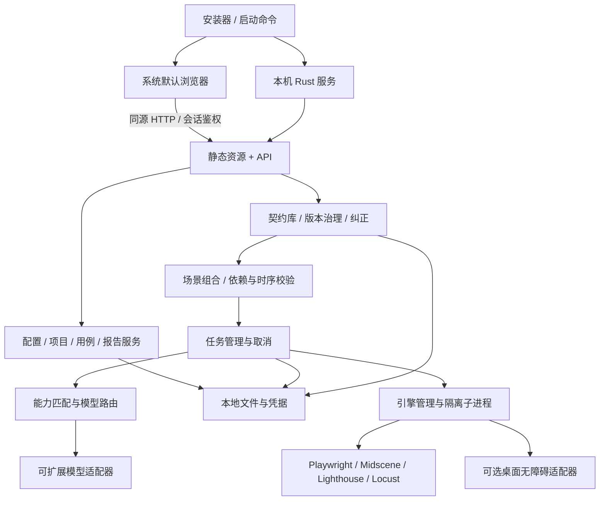

# QinAegis 2.0 产品方案与完整实现计划

- 编写日期：2026-11-13；更新日期：2026-11-18
- 状态：用户已于 2026-11-13 授权实施，按阶段开发；本文件描述完整目标，已实现范围与验证证据见开发进度，尚未正式发布。
- 产品核心：跨项目复用、可维护、可修改、可纠正的契约；模型与执行能力可替换，场景可组合、时序可调整。
- 核心测试技术基础：基于 Playwright + Midscene.js 的视觉驱动测试；通过适配层与可复用契约、模型配置和场景编排衔接。
- 交付形态：本地 Web 工作台 + 本机服务 + 按需安装的引擎；停止桌面客户端打包。
- 项目长期记忆：[CONTEXT.md](../../CONTEXT.md)，2026-11-13 用户明确补充了契约、解耦、模型与无障碍辅助场景要求。
- 实施授权：用户已明确“提交下，开始开发”并持续要求推进；分阶段开发已经授权。系统权限、真实数据迁移及正式发布仍按各自边界处理，不因方向确认自动获得授权。
- 当前入口：[文档索引](../README.md)、[用户指南](../USER_GUIDE.md)、[开发进度](../progress/local-web-2.0.md)、[验收 checklist](../progress/acceptance-checklist-2.0.md)、[CI 与网站交付](../CI_INTEGRATION.md)。后续章节中的完整产品行为与建议指标属于目标，不能直接推断为已实现。

## 2026-11-18 目标校准

用户三维拆解与代码复盘见[能力图谱](capability-map-review-2.0.md)，由[产品 Agent](../agents/product.md)落实目标、范围和状态。保留可复用契约为核心，补入过程证据 E01–E04、统一审计 G01、需求覆盖 G02 和可复核辅助归因 M07；安全暂停/同会话继续/受限接管单列 H01–H03 后续阶段。任务详细完成条件以清单为准。

当前 F01–F05、持久任务/中断查看、原生运行时维护和 Windows 安装器已有各自限定验收；不能继续写成尚无实现。版本化采集策略、受管过程附件、官方 Trace 查看、变更审计和用例历史已有本机验收；Trace 暂存硬配额与完整故障矩阵仍未完成，Web AI 根因分析、暂停/继续/接管尚未实现，不能凭 Playwright 底层接口、知识库或宣传卡片推定可用。性能/压测仍需真实工具验收，本机服务不等于整个产品零依赖、无出网或操作系统安全沙箱。本节补充后续章节的完整目标，不将设计文件当成实现证据。

## 1. 产品定位与目标

QinAegis 2.0 是安装在个人电脑上的本地 AI 质量工程工作台。用户安装后启动服务，系统自动打开默认浏览器，所有日常配置、项目管理、探索、生成、审核、测试执行、报告与维护均在浏览器中完成。

“轻量化”有三个明确含义：

1. 删除 tao/wry 原生窗口、WebView 私有协议、注入桥接脚本、应用图标生成与 `.app`/DMG/cask 打包链路。
2. 前端构建产物内嵌在本地服务中；用户使用工作台无需安装 Rust、前端 Node 开发环境或运行 Vite。
3. 大体积浏览器和外部测试引擎按能力安装，展示下载大小和用途，不将所有依赖强塞进基础包。使用相应测试功能时，确实需要对应引擎。

本版本聚焦单用户、本机使用。团队账号、远程访问、云端托管、多租户、调度集群、插件市场和移动原生客户端不进入 2.0 范围。现有自动化与可靠性能力以源码和端到端验收为准，不能把路线图或介绍页上的能力直接标记为已交付。

### 1.1 核心资产：可复用的测试契约

产品价值以可复用契约的积累和演进为中心，本地 Web 是承载形式。契约不是特定厂商的提示词、某种脚本或 HTTP schema 的别名，而是对业务行为及其验证要求的结构化表达。

采用四层分离：**通用契约模板 → 项目/环境绑定 → 场景流程 → 运行与证据**。目标是任何自动化测试项目均能通过明确绑定和适配复用契约体系，不承诺一个未适配执行器可以覆盖所有应用。

| 契约组成 | 必须表达的内容 |
|---|---|
| 标识与演进 | 稳定 ID、schema 版本、契约版本、描述、来源、状态、派生关系 |
| 业务行为 | 意图、输入输出类型、前置/后置条件、不变量、可验证断言 |
| 能力与限制 | 所需能力、授权范围、副作用、幂等性、资源、超时与重试边界 |
| 绑定 | 参数槽位、项目规则、环境和目标引用；秘密仅存引用 |
| 验证与证据 | 判定方式、证据类型、置信/人工复核要求、错误分类 |
| 治理 | 修订原因、作者/模型来源、审核与验证记录、兼容性和引用影响 |

通用模板不得写死域名、账号、定位器、模型、引擎或本机路径。项目特定业务差异采用显式参数、覆盖或派生；派生不可悄悄修改共享模板。用例引用契约版本并绑定输入，流程引用用例/能力，具体脚本由适配器生成或绑定。

### 1.2 契约维护、修改与纠正闭环

- Web 提供契约库、查找/创建/编辑、参数绑定、差异、校验、试运行、审核、发布、弃用、版本回滚、导入导出及引用影响视图。
- 草稿可修改；发布版本不可原地覆盖。项目和流程固定引用版本，升级有迁移提示、差异与回归证据；历史结果始终指向当时快照。
- 纠正链路：问题/证据 → 分类（契约错误、绑定错误、执行器错误或被测缺陷）→ 修订建议 → 差异审查 → 隔离验证 → 批准新版本 → 选择性升级引用。
- 模型可建议纠正，但不能自己批准其业务预期修改。修复选择器或等待条件与修改业务断言分开审核，不能为通过测试自动弱化预期或跳过必需动作。
- 同时编辑使用修订号检测冲突；库依赖检查防循环，导入预览处理 ID/版本冲突，复用包默认无凭据和敏感证据。
- 本机跨项目契约库属于首版范围；远程市场、在线协作不作为前置依赖。

示例：通用“已授权用户提交合法表单后获得成功结果”定义输入、前后置和证据；项目 A/B 分别绑定目标页面、字段语义与成功判定。跨项目复用流程结构，业务差异显式绑定或派生；不能将 A 的成功条件强套 B。

### 1.3 模型与核心职责解耦

- 领域契约不依赖模型厂商、Playwright/Midscene、桌面无障碍实现、存储或前端。
- 分离契约治理、场景编排、模型路由、探索/生成、执行适配、验证门禁、任务生命周期、存储报告和权限策略；各模块通过能力声明、类型化输入输出和统一错误/证据交互。
- 优先演进现有 `LlmClient`、`BrowserAutomation`、`Storage`，不重建重复框架；核心依赖可替换，但替换必须通过同一组契约一致性测试。
- 模型注册支持多个 provider/配置，声明文本、视觉、结构化输出、工具调用等能力。Web 可添加、连接检测、按项目/场景/步骤切换，而非固定两项主备。
- 探索、生成、操作和纠正建议可分别选模型；路由考虑能力、数据授权、超时、配额和预算。能力不足或降级违反授权时明确失败。
- 运行冻结契约、计划、绑定及模型策略快照；下一次运行使用修改后的配置。运行中只允许已声明的降级策略切换，并记录实际模型、原因与版本，不能改变业务预期。
- 模型质量不确定与业务断言失败分开报告。确定性检查优先，AI 判定附证据并允许人工复核。

### 1.4 真实场景组合与执行时序

探索 → 生成 → 审核 → 执行 → 报告仅为默认流程模板。用户可复用已有契约直接执行，组合 API 建数、桌面准备、浏览器动作、结果验证与清理，并按依赖调整顺序。

流程资产包含步骤 ID、能力/契约版本引用、类型化输入输出、依赖、条件、等待事件、超时、有界重试、失败分支、补偿/清理与资源互斥。首版使用声明式 DAG 和表单编辑即可，不要求先实现复杂画布。

调序/组合必须先校验无环、类型一致、数据来源、前置条件、能力兼容、授权与副作用。无法满足依赖时拒绝保存/启动并指出冲突。非幂等步骤不得自动重放，清理必须在失败与取消路径触发；补偿策略不能宣称一定能撤销外部动作。流程修改创建新版本，不热改运行中计划。

### 1.4.1 核心测试技术基础的保留要求

2026-11-13 用户明确：基于 Playwright + Midscene.js 的视觉驱动测试同样是必须写入产品记忆并持续保留的核心技术基础。Playwright 承担浏览器自动化与生命周期，Midscene.js 承载视觉驱动动作、断言和抽取；具体能力以版本和实际执行验证为准。

契约是可复用的业务与验证资产，该技术组合负责执行落地。模型切换、流程组合和桌面无障碍辅助均通过清晰接口衔接；解耦不代表本轮获准移除或全量替换这套核心路线。2.0 必须验证其脱离源码的安装与运行、模型兼容、契约复用、取消和证据链路；任何核心路线替换需单独确认。

### 1.5 可选场景能力：授权无障碍控制电脑

用户于 2026-11-13 要求将电脑无障碍控制作为场景辅助能力。纳入产品核心能力组合设计，是否进入 2.0 GA 的具体平台和动作范围在 P0 验证后确认；不因此立即开发或申请系统权限。

- 桌面适配器与浏览器/API 适配器并列，可处理系统文件选择、原生弹窗、应用切换、桌面准备与结果读取；无需重建桌面客户端。
- Web 配置用途、目标应用/窗口、允许动作、证据与权限。默认关闭，用户在系统授权后才启用；无障碍读取、输入控制、截图分别检测，不隐含授权。
- 运行前校验目标窗口和元素语义，执行后验证结果；无法可靠定位或前台状态改变时停止并提供接管，不盲目输入。
- 对键鼠和前台焦点加互斥锁；运行中显示状态，提供任务取消和独立紧急停止。服务异常不得继续输入，停止不关闭无关应用。
- 截图/剪贴板/文件和敏感输入受单独策略约束；模型接收桌面内容需满足允许的数据接收方策略，秘密字段不进入日志/普通证据。
- 支付、发送、删除或系统配置修改等高影响动作需独立策略与确认，无障碍授权不能替代动作授权，不绕过系统保护。
- 拒绝/撤销权限、锁屏、窗口消失、多屏缩放、焦点抢占、平台不支持和远程会话差异均有检测、明确错误与安全退出。
- 先以本机 macOS 为可行性验证对象；其他平台由独立适配器验证，不假定系统权限和控制方式相同。需要辅助进程时按需启动，不引入常驻客户端外壳。

### 1.6 Allure 与不可变执行事实

2026-11-16 用户明确要求 Allure。采用官方 Allure 3，当前锁定 `allure@3.33.0`，复用 Node 执行运行时，不新增桌面壳或 Java 报告服务。

- 执行前冻结已批准脚本、契约/绑定/输入、目标和脱敏模型快照；终态 `run.json` 为事实源，后续修改不能重写它。
- 终态导出标准 `allure-results`；Web 显式生成、查看和下载官方单文件 HTML。报告生成失败独立诊断，不改变测试事实或门禁。
- 部分结果、取消、初始化及 shutdown 失败独立可见；全部返回用例通过也不能掩盖运行失败。不虚构缺失的动作步骤、截图或逐用例起止时间。
- 保留真实来源、脚本与已有证据，报告文件私有保存。HTML 在不授予同源权限的沙箱中查看；嵌入和下载都限制联网并移除固定模板统计加载。凭据不进入报告，附件分享须用户显式操作。
- 当前实现为单次运行报告，跨次历史/趋势、真实双项目业务视觉报告仍待验收。Allure 生成成功不证明契约语义已被脚本完整实现。

### 1.7 Web 交互与公开文档

工作台和官网统一复用官方 beUI 公开免费组件，按场景复制完整源码及必要依赖，记录来源摘要；不引入 Pro/付费组件，不为展示目录而无差别打包。组件只负责交互，不能改变人工审核、CAS、密钥脱敏、取消或错误语义。键盘、焦点恢复、减少动效和窄屏均需真实浏览器验收。

公开 GitHub Pages 与本机工作台独立构建，不连接本机 RPC、不读取配置、不加载统计和远程字体。官网展示契约复用、模型/执行分工与开发状态；PR 提供预览，main 才部署生产页面。README、安装/使用手册、路线图、CI 与变更记录同步当前 2.0；旧设计和评审保留历史并标注替代关系。

## 2. 改造前基线与依据（2026-11-13 历史对照）

下表保留最初方案读取的旧架构，不描述当前 2.0 源码。当前版本已为 2.0.0，tao/wry 已删除，HTTP、契约/模型治理与 Allure 已进入开发分支；具体以开发进度为准。

| 领域 | 改造前源码事实 | 对 2.0 的影响 |
|---|---|---|
| 工作区 | `Cargo.toml` 包含 core 与 web_client，版本为 0.7.2 | 统一升级为 2.0.0，并独立管理数据格式版本 |
| 桌面入口 | `crates/web_client/src/main.rs` 使用 tao/wry | 删除窗口循环，保留业务服务 |
| 前端通信 | `ui/src/utils/rpc.ts` 请求 `app://localhost/invoke`，参数放查询串 | 改为同源 HTTP JSON，不让凭据进入 URL |
| 业务边界 | 配置、项目、任务、报告与协议分发集中在 main.rs | 抽离有边界的模块，不重写所有 core |
| 静态资源 | `assets.rs` 引用 React 编译后的 HTML/JS/CSS | 发布前强制构建校验；运行时无需源码目录 |
| 任务 | 内存 HashMap、线程内 runtime、轮询、cancel_flag | 需要持久任务摘要、可靠取消与重启中断标记 |
| 配置 | `AppConfig::global_path()` 使用 `dirs::config_dir()`；项目数据在 `~/.qinAegis` | macOS/Linux/Windows 实际配置目录不同，不能按文档写死 |
| 配置接口 | 返回完整配置，部分调试输出包含配置及请求参数 | 掩码返回、秘密字段补丁语义、日志脱敏为上线条件 |
| 外部运行时 | `protocol.rs` 从编译期源码路径寻找 sandbox 与 tsx | 必须改为安装路径解析与运行时版本清单 |
| 自动化 | 存在 Midscene 与 NativeAutomation 两条实现 | 先保留现用路径，不能未经验证强行全切 Rust 原生引擎 |
| 测试依赖 | sandbox 含 Playwright/Midscene；压测实际存在 Locust 路径 | 以真实调用链确定依赖，不按 README 中 k6 描述做假设 |
| 发布 | release/build 脚本生成 .app/DMG，Homebrew 使用 cask | 替换为服务归档、安装器与 Formula |
| 文档 | README、用户手册、安装说明在版本、路径、引擎上不一致 | 发布时统一重写；历史设计文档保留并标注历史 |

本次仅完成静态读取。此前试启动的 Cargo 验证因 crates.io DNS 不可达失败，没有测试通过的证据；新增测试准备代码已撤回。方案不能据此保证现有业务全部可用。

## 3. 用户与完整使用旅程

### 3.1 首次安装与启动

1. 用户下载对应系统的安装脚本，或在发布页复制一条安装命令。
2. 安装器检测操作系统、架构、用户目录可写性、网络与磁盘容量；下载对应固定版本基础包并核对 SHA-256。
3. 默认安装到当前用户目录，无管理员权限，不修改系统 Python/Node，不自动修改 shell 配置。
4. 创建启动入口，启动后台服务，等待就绪后打开默认浏览器；成功页给出访问地址、日志位置和停止方法。
5. Web 首次设置显示“基础服务就绪”，允许先创建项目、查看旧资产；AI 凭据与引擎尚未准备好时，只禁用依赖它们的操作。
6. 用户配置模型并测试连接，再选择所需引擎；安装过程在 Web 中显示下载、校验、解压、检测的进度。
7. 创建项目后选择复用/绑定既有契约，或通过探索与生成形成草稿；审核发布后组合场景执行，查看报告，按证据纠正并按需重跑。首次使用提供默认闭环模板。

“一键安装”指不需要拉取源码、编译或手工执行 npm；模型凭据和被测系统登录仍需用户提供。下载失败、离线或缺少系统组件时明确显示限制，不伪报安装成功。

### 3.2 后续启动与日常使用

- 启动入口默认复用已有健康实例并打开浏览器；多次点击不得创建重复服务或多套浏览器引擎。
- 关闭标签页不停止后台任务；重新进入后恢复任务列表和日志位置。
- 未在运行时，启动入口拉起后台服务；运行中可从 Web 查看版本、依赖状态、数据目录和磁盘占用。
- 退出服务前检查运行任务；普通退出等待清理，强制退出需单独确认。
- 默认不开机自启；在设置中可启用当前用户登录后启动，启动服务时不主动弹浏览器。

### 3.3 断网与异常

- 离线仍可打开工作台、读取配置和已有项目/用例/报告。
- AI、依赖下载、更新检查等显示“当前不可用”与原因；已有本地引擎能运行的任务照常使用。
- 浏览器打开失败：服务保持运行，提供复制地址及重新打开按钮/命令。
- 服务不可达：前端显示重连状态，不将连接失败误判为首次配置，不清空正在编辑的内容。

## 4. 2.0 功能范围与页面设计

采用复用现有 React 的渐进调整，保留桌面宽屏操作习惯。统一中文文案和错误提示，模型名、引擎名、标准字段保留英文；中英完整国际化作为后续版本。

导航：总览、契约库、场景流程、项目、探索、生成、用例、执行、任务中心、报告、环境与引擎、设置（含模型管理与桌面辅助权限）。项目相关页面共享当前项目选择；无项目时引导创建。

| 页面 | 必须提供的功能 | 空白/失败/边界状态 |
|---|---|---|
| 总览 | 项目数、最近任务、门禁摘要、服务与引擎状态、下一步引导 | 无项目、未配置模型、引擎缺失不阻断浏览 |
| 契约库 | 模板/派生、版本、编辑校验、差异审核、纠正、影响分析、共享导入导出 | 冲突、破坏性变更、非法断言、受影响引用、敏感数据检测 |
| 场景流程 | 能力/契约组合、输入输出绑定、依赖与调序、分支、等待、重试/清理、计划预览 | 缺依赖、环、类型不符、资源/授权冲突、非幂等重试 |
| 项目 | 创建、列表、详情、编辑 URL/技术栈、绑定契约版本/场景、归档、导出/导入 | 同名冲突、非法 ID、重复导入、目标不可达 |
| 探索 | 选择项目与 URL、深度/页数限制、启动/取消、进度、结果预览与保存 | 凭据缺失、鉴权页、超时、部分成功、覆盖前保留历史 |
| 生成 | 选择项目/规格书、需求输入、启动、查看生成结果 | 空需求、规格缺失、输出不合法、模型限流；允许修订后重试 |
| 用例 | 按状态筛选、详情、编辑、格式校验、审核流转、批量选择 | 不合法内容不能批准；已归档只读；修改批准用例需重新审核 |
| 执行 | 类型/用例选择、前置检查、计划预览、并发/超时、执行与取消 | 无匹配用例不能展示“通过”；缺引擎给安装入口 |
| 任务中心 | 全局任务列表、状态/项目筛选、日志、取消、重跑 | 刷新恢复、重启中断、队列满、日志截断、任务已被其他标签取消 |
| 报告 | 历史列表、用例结果、性能/压测指标、门禁、HTML、导出下载 | 无报告、损坏报告、缺截图、部分失败；缺数据不能当零分或通过 |
| 环境与引擎 | 检测、能力列表、安装/修复/升级/移除、日志和大小 | 网络失败、权限不足、磁盘不足、校验失败、版本不兼容 |
| 设置 | 主/备模型、连接检测、浏览器/CDP、高级参数、服务与数据维护 | 无效地址、未解析环境变量、端口冲突、保存冲突、备份失败 |

范围边界：项目删除只做可恢复的归档；硬删除数据必须单独确认。第一版保留既有用例状态 draft/reviewed/approved/flaky/archived，明确允许的转换，归档恢复返回 draft。重试创建新任务并关联原任务，不覆盖失败证据。

### 4.1 模型与被测系统配置

- 模型注册项：provider、base URL、model、API Key 引用、能力和策略；可添加多个配置，分别检测。主/备是可复用策略模板，项目/场景/步骤可按授权范围选择配置。
- 不把当前默认厂商/型号写成产品唯一支持项；只展示经过对应协议验收的适配器。
- 未配置模型不阻止普通资产管理；依赖 AI 的按钮显示所缺配置。
- 连接检测有超时与可见状态，不触发长任务；区分认证、网络、模型不支持、配额错误。
- API Key 默认掩码；空字段表示保持，显式“清除”才删除，修改后不回传完整密钥。
- 环境变量引用显示来源与是否解析，不显示解析值；缺失时阻止相关任务并提示变量名。
- 被测网站登录使用项目级隔离的浏览器会话/认证状态导入或交互登录；加密与权限处理纳入凭据策略。无痕测试上下文与工作台所在浏览器分开。
- API Key、Cookie、认证状态不进入默认导出、诊断包和日志。截图/页面文本可能含敏感数据，页面明确说明 AI 任务会把相关内容发往所配置模型提供方。

### 4.2 能力与引擎矩阵

| 能力 | 所需环境 | 安装策略 |
|---|---|---|
| 工作台、配置、资产、历史报告 | 基础服务 + 用户已有浏览器 | 基础包内置；无 Node/Python 要求 |
| 纯模型生成 | 已配置模型和网络 | 无浏览器引擎要求 |
| 探索、冒烟、功能、视觉操作 | 锁定版本的 Node、sandbox、Playwright/Midscene、自动化浏览器 | 推荐引擎包；安装器默认推荐，Web 可延后安装 |
| 性能测试 | 实际 runner 所需的 Lighthouse 与浏览器环境 | 独立能力项，按现有调用链验证依赖 |
| 压测 | Locust + 独立 Python 环境及 runner 资源 | 独立按需安装，不污染系统环境 |
| ZAP 等集成 | 对应外部服务或运行时 | ZAP 在受管容器取消实现前明确不可用；其他集成按端到端验收结果标注 |

NativeAutomation 不作为本次消除所有 Node 依赖的承诺。若实测其能力不足，继续使用推荐引擎；后续版本再逐步替换，避免轻量化破坏功能。

外部引擎不得由页面传入任意命令安装；固定清单指定下载源、版本、校验和、入口与支持平台。基础包体积与引擎大小分别显示。

## 5. 安装、启动、生命周期与平台策略

### 5.1 平台与发行物

2.0 GA 基线建议为 macOS Apple Silicon、macOS Intel、Linux x86_64、Windows x86_64。各平台只有在干净环境通过完整安装与核心链路测试后才能标为正式支持。Linux ARM64、Windows ARM64 留待后续；Linux 还需明确经过测试的发行版与 glibc 下限。

- macOS/Linux：服务归档 + POSIX shell 安装器；Windows：zip + PowerShell 安装器。
- Homebrew 从 cask 改 Formula；不生成 `.app`、DMG、Electron/Tauri/WebView 外壳或 MSI GUI 安装器。
- 安装介质可以是压缩包，包内包含服务、资源清单、必要许可证；UI 内嵌，基础包不附带整个 Node/Python/Chromium。
- 安装器支持固定版本与本地离线包；版本号、目标平台、校验和必须一致。发布页给脚本内容与手动安装方式。
- 下载校验基于可信发布渠道，SHA-256 负责完整性，不宣称其等价于独立签名。macOS 签名/公证、Windows 签名是否可用在 RC 明确验证，禁止通过自动删除隔离属性或关闭系统安全机制掩盖问题。

### 5.2 命令与入口契约（规划）

| 命令 | 行为 |
|---|---|
| `qinaegis` / `qinaegis start` | 后台启动或复用服务，等待健康检查，默认打开浏览器 |
| `qinaegis serve --no-open` | 前台运行，适合开发和 CI；Ctrl+C 优雅退出 |
| `qinaegis open` | 打开现有实例；未启动则给出启动方式 |
| `qinaegis status` | 状态、版本、PID、URL、数据/日志位置，不展示秘密 |
| `qinaegis stop` | 请求优雅停止；有运行任务时给明确结果；强制需显式参数 |
| `qinaegis doctor` | 只读诊断；修复使用显式选项，Web 也可操作 |
| `qinaegis version` | 输出程序、API、数据与引擎版本 |

命令名称统一小写；旧 `qinAegis-web` 可保留一个过渡命令别名，文档只推荐新名称。Web 提供对应日常操作入口，CLI 为安装、故障与 CI 的补充。

### 5.3 端口、实例与关停规则

- 默认监听 `127.0.0.1:19876`，端口可配置；不开放公网或局域网监听选项。
- 默认端口被其他程序占用时，在有限候选端口内选择可用端口并保存实际地址；用户显式指定端口时失败即报错。
- 同一数据目录只允许一个服务写入；锁定操作必须原子，不能只凭 PID 文件判定。
- 复用实例要验证服务标识、协议兼容与会话握手；不能对占用端口的任意 HTTP 服务当作本产品自动打开。
- 服务就绪要求：数据锁、存储、路由和会话可用后才通知启动成功；引擎未安装不影响基础就绪。
- 正常停止：停止接新任务、取消/等待运行任务、关闭其子进程、落盘、释放锁。建议宽限 15 秒，超时显示阻塞项；必要时只结束本服务拥有的进程树。
- 更新期间与执行任务互斥；关闭 Web 标签页不退出服务。开机自启仅用户级，macOS/Linux/Windows 分别验收，不通过系统级提权安装守护进程。

## 6. 技术架构与接口方案

### 6.1 模块与复用原则

- core 保留领域模型、存储、生成、执行、门禁与现有适配器。
- 已将 `main` 业务移入应用服务与分发模块，HTTP、会话与生命周期独立；crate 路径暂保留 `web_client`，可执行文件为 `qinaegis`。不为目录改名增加交付风险。
- server 划分 bootstrap、http/routes、session、jobs、engine_manager、lifecycle；只在职责需要时拆模块，不增加通用插件平台。
- React 保留现有组件和样式，逐页补齐入口、能力检查与异常处理；删除注入的全局 RPC 和重复旧静态界面前，确认没有活跃调用方。
- 不引入数据库、Redis、Docker 必选依赖。采用现有文件存储 + 有界任务队列。
- HTTP 已采用 axum 0.8，复用 tokio/serde；不自行手写 HTTP 解析器。后续依赖变更继续遵守最小依赖与锁文件原则。
- 依赖锁文件进入版本控制，UI 和引擎均使用可重复安装；禁止浮动 latest 参与已发布引擎安装。

当前私有数据目录支持显式绝对路径 `QINAEGIS_DATA_DIR`，统一隔离项目、契约、模型、服务状态、默认运行时和配置；空/相对路径在写入前拒绝。未设置时保持既有项目与操作系统配置路径，不自动迁移资产。平台验收需断言实际数据根，不能依赖 Windows 会忽略的 HOME/APPDATA 重定向。

### 6.2 Web 传输接口契约（与产品测试契约区分）

建议保留 RPC 业务方法命名以缩小迁移面，统一入口为 `POST /api/v2/rpc`，静态页面与 API 同源。内部引擎 JSON-RPC 协议与浏览器 API 分开，不把引擎协议直接暴露给页面。

请求示例：`{ "id": "request-id", "method": "runTests", "params": { "project": "project-id", "type": "smoke" } }`。

当前响应：成功 `{id, ok:true, data}`；失败含 `{id, ok:false, error:{code,message}}`。扩展结构化 details/retryable 属于后续目标，不要求客户端假定已存在。前端区分 HTTP、协议、业务错误；不再混用字符串 JSON 和任意错误对象。

| 分组 | 保留/新增的方法 |
|---|---|
| 配置 | getState/checkConfig/setConfig；新增 testModel、配置版本与秘密字段状态 |
| 契约治理 | 新增契约模板/版本、绑定、派生、差异、校验、纠正提案、审核发布/弃用、引用影响、导入导出 |
| 场景组合 | 新增流程草稿/版本、步骤能力目录、依赖与调序校验、计划预览、版本发布与执行 |
| 模型与授权 | 新增模型配置/能力检测/路由策略、桌面权限状态/范围与紧急停止；API 不代替系统授权 |
| 项目 | getProjects/createProject/exportProject；补详情、编辑、归档、受控导入 |
| 探索与生成 | runExplore/runGenerate；补项目与规格版本关联 |
| 用例 | getReviewCases/updateCaseStatus；补详情、编辑、校验、批量状态转换 |
| 执行 | previewTestPlan/runTests；补运行参数、前置检测与幂等键 |
| 任务 | getJobStatus/stopJob/getOutput；补 listJobs、增量日志、关联重跑 |
| 报告 | getReports/getGateStatus/getReportHtml；已有运行证据和 Allure 生成/读取/下载，分页/跨次趋势仍待完善 |
| 环境 | 新增引擎状态、安装/修复/移除任务、诊断、磁盘与缓存管理 |
| 系统 | getVersion/checkUpdate；新增服务状态、备份、更新检查/准备与关停 |

独立路由：`GET /healthz` 只返回就绪和产品协议标识；文件下载按项目/运行/产物 ID 寻址，禁止任意绝对路径。退出请求必须先响应再异步关停。

第一版继续短轮询，避免同时维护 WebSocket/SSE 两套机制；运行任务约 1 秒轮询、后台标签降频、无任务停止轮询。日志使用 offset/cursor 增量读取；断线重连补读，不重复追加。未来有测量依据再引入 SSE。

建议初始限额：普通请求体 1 MiB、受控导入 20 MiB、并发 HTTP 请求 32、全局排队任务实际采用 8；任务提交 2 秒内返回 ID。导入格式、分页大小和请求超时作为接口规范常量统一管理，超限返回明确错误。

### 6.3 任务调度与取消

- 状态机：queued → running → succeeded/failed；取消经过 cancelling → cancelled；异常退出遗留 running 标记 interrupted。
- 保存任务 ID、项目、类型、参数摘要、配置版本、引擎版本、开始结束时间、结果引用和错误码；秘密不写入参数摘要。
- 任务 ID 与运行 ID 使用足够随机性，避免当前秒级时间戳冲突。
- 2.0 当前采用全局一个执行槽、最多八个 FIFO 等待任务，覆盖所有已启用任务，串行保护项目与浏览器资源；桌面能力尚未启用。提交冻结输入，排队位置与原因可见，清理及最终历史落盘后才启动下一项；持久化失败阻止后续动作。多资源并发是后续独立范围。
- 每个浏览器任务独立 profile、端口和工作目录；不要将一个固定 CDP 端口分给并行任务。
- 取消向内部异步操作和整个受管子进程树传播；只设置标志不能显示取消完成。终态只写一次，完成与取消竞争不得互相覆盖。
- 服务重启不自动重放有外部副作用的测试；用户可查看中断证据后重跑。
- 任务持久化使用原子临时文件替换；日志轮转、有界内存环形缓冲；锁顺序统一，不在持有输出锁时反向等待任务锁。
- 禁止在 HTTP 请求持全局锁执行网络请求、长耗时文件操作或新建嵌套 runtime。

## 7. 数据、迁移、备份与凭据

### 7.1 目录约定

保留旧项目根 `~/.qinAegis/projects`，不在升级时无必要搬迁。建议在 `~/.qinAegis` 下增加 `state/`（实例信息与任务）、`logs/`、`backups/`、`cache/`、`runtimes/` 和 `versions/`；平台安装程序置于用户本地程序目录，实际路径由状态页展示。

全局配置优先继续使用现有 `dirs::config_dir()/qinAegis/config.toml`，按平台解析；旧说明中的 `~/.config` 与 `~/.qinAegis/config.toml` 只作遗留候选路径。发现多个来源时展示来源和差异，用户明确选定，不静默合并秘密或覆盖。

项目保留 `config.yaml`、规格书、按状态分目录的用例和 reports。兼容已有 `spec.md` 与 spec 目录、flat cases 与状态目录；读取兼容，写入逐步规范，迁移记录包含源文件与校验摘要。

契约库与流程资产需要独立版本存储：共享模板、项目绑定、流程版本、修订提案及引用索引分别保存；发布内容不可变。运行元数据引用准确版本与摘要，默认导出只含契约和可公开绑定。具体目录/schema 在 P0 定案，迁移前不可覆盖旧用例。

### 7.2 配置规则

- 程序版本、API 版本、配置 schema、项目格式、引擎版本各自独立。
- 优先级：内置默认 → 全局配置 → 项目允许覆盖字段 → 本次任务显式参数；CLI 服务启动参数仅覆盖服务项。环境变量仅对明确引用字段解析，不暗中覆盖所有已保存设置。
- Provider、探索深度/页数、超时/并发等字段都需从 Web 读写；禁止前端显示但服务忽略。
- 设置保存为原子写入，校验通过才替换；使用修订号拒绝多个标签页的过期覆盖。
- 改配置不影响正在执行任务；任务启动时冻结有效配置摘要，密钥仅在内存受控使用。

### 7.3 迁移流程

当前配置子集已实现：Settings 从固定已知来源预览脱敏结果，显式选择主/备用凭据策略并确认；10 分钟预览核对源/目标原文，写入前备份、重复结果幂等，保留源文件。不支持任意路径、自动合并秘密、模型库或项目资产迁移。Reports 已提供 5 分钟预览确认的受管 Allure 暂存清理；未知残留、运行事实与完整报告保留。以下全量资产迁移仍为目标，不能以配置子集实现替代验收。

1. 首次启动检测旧配置/项目，展示迁移预览；找不到旧数据不代表可以清空其他目录。
2. 迁移前备份原配置和将被修改的资产，核对磁盘空间。
3. 逐项转换并校验数量、ID、关键字段与可读性；坏文件隔离报告，不跳过后宣称全部成功。
4. 成功才切换 schema 标记；失败保留旧文件与可重试状态，重复迁移不得复制项目或用例。
5. 导出包括项目元数据、规格、用例、报告及清单，默认排除凭据。导入先预览，默认创建新项目，冲突不可直接覆盖。
6. 程序回滚与数据回滚分开；旧程序不能读取新格式时必须用对应备份恢复，不能声称只替换二进制就完成回滚。

### 7.4 凭据与保留策略

首版推荐沿用本地配置文件并强化权限：Unix 配置目录 0700、秘密文件 0600；Windows 当前用户 ACL。不能将普通 JSON/TOML 宣称为加密存储。系统密钥链接入作为独立可批准项，未做之前明确本机同用户进程/管理员仍可能访问凭据。

日志默认按大小轮转并保留 7 天、下载缓存按最近使用清理；报告默认不自动删除。Web 显示占用并允许选择清理。备份含凭据时明确标注敏感性且禁止默认通过浏览器分享；诊断包先预览并脱敏。

## 8. 本地 Web 安全与边界

移除桌面协议后，HTTP 是新增访问面，以下属于 2.0 基本验收而非后续增强：

- 仅 loopback 监听；严格 Host 白名单含实际端口，防止 DNS rebinding；IPv6 如启用只绑定 `::1`，不得通配。
- 每次服务启动生成随机会话凭据。启动器通过短时、一次性 bootstrap token 打开页面，建议放 URL fragment；交换后立刻清理浏览器地址并使用 HttpOnly、SameSite=Strict 会话 Cookie。会话和 token 不进入访问日志。
- 所有状态修改采用 POST + JSON + Origin 校验与 CSRF token；不设置通配 CORS，不允许 GET 配置保存/取消/关停。无 Origin 的 CLI 调用必须使用独立本地凭据，不靠“本地请求”自动放行。
- 新浏览器/隐私窗口需重新通过受信启动入口授权；会话有空闲超时，重启失效。同用户终端可重新打开，不把产品设计为多人身份系统。
- API Key 不在 URL、错误栈、日志、报告和默认配置响应中出现。
- 所有 project/case/run/artifact ID 严格校验；路径归一化后必须位于数据根，拒绝 `..`、编码绕过、绝对路径和符号链接逃逸。
- 报告与模型输出视为不可信内容：Markdown 清洗，HTML 报告放 sandbox iframe，禁止同源脚本权限；禁止报告脚本读取配置 API。
- 静态资源白名单与正确 MIME；不存在资源真实返回 404；API 不做 SPA 回退；配置/API 响应 no-store。设置 nosniff、Referrer-Policy、frame-ancestors/CSP。
- 压测默认保守限制并展示并发/时长/目标；首次主动扫描或压测要求用户确认目标授权，不在安装检测中向项目发起扫描。
- 被测内网地址是合法场景，不一刀切拦截私网；禁止非 http(s) 协议，并防止将模型/下载配置演变为任意文件访问或任意 shell 执行。
- 运行时下载只能来自发布清单可信源；失败包不可执行，安装目录原子切换；外部命令使用参数数组，不拼接 shell。

## 9. 运行时交付、升级与离线策略

- 为基础服务和每种引擎维护 manifest：版本、平台、依赖、下载源、大小、摘要、入口、最低服务版本、许可证。
- 推荐引擎包必须包括 sandbox 实际运行入口及其锁定依赖；开发期可构建为 JS 产物，不能要求安装机器具备 tsx 或构建目录。采用预装包还是安装期还原依赖，在 P0 用干净环境体积/兼容性实验定案并记录。
- Node 优先用户隔离的兼容运行时；允许使用检测通过的已有版本。Python/Locust 使用隔离环境；缺少系统级动态库时给明确诊断，不静默 sudo 或修改系统环境。
- Playwright 浏览器与工作台使用的默认浏览器独立；工作台可以 Safari/Edge 打开，但自动化使用经过引擎验证的浏览器。
- 运行时定位来自已验证安装清单，不能残留 `env!(CARGO_MANIFEST_DIR)`、开发者绝对路径或依赖 cwd；必须从任意目录运行成功。
- 引擎安装是持久任务，可取消、失败重试、清理临时文件；磁盘预检考虑下载包、解压目录和旧版本并存，不只看压缩大小。
- 网络设置支持代理、超时和重试；不保存未经掩码的代理密码。离线包的 manifest 与摘要必须验证，不能从不可信目录自动发现并执行程序。
- 更新默认仅检查并提示，不打断任务、不自动升级引擎。用户在 Web 点击更新后，下载准备 → 校验 → 备份 → 停服切换 → 新版健康检查 → 成功；失败自动回到旧程序，必要时按迁移备份恢复数据。
- 更新执行由独立短命 helper/启动器负责，特别是 Windows 不能让运行中的 exe 覆盖自身；helper 不变成常驻客户端。
- Homebrew 安装的程序交由 Homebrew 更新，Web 展示渠道与明确命令，不越权覆盖包管理器文件。
- 卸载默认仅移除程序/自启/缓存，保留项目数据；彻底删除单独确认并提供备份入口。

## 10. 非功能指标与验收方法

以下为目标值，需 P0 建立基准、RC 实测，不能作为已实现数据对外宣传：

| 指标 | 2.0 目标 | 测量口径 |
|---|---|---|
| 基础服务就绪 | 冷启动 ≤3 秒 | 本地 SSD、无迁移、服务启动到 healthz 成功；浏览器加载单列 |
| 空闲内存 | 服务 RSS ≤100 MiB | 不含用户浏览器与引擎，空闲 60 秒测量 |
| 基础包 | 压缩 ≤50 MiB 为优化目标 | 各平台独立报告；超标记录原因，不以删除能力换指标 |
| UI/本地普通 API | API p95 ≤200 ms | 不含模型、引擎、全量导出、冷磁盘；固定测试数据集 |
| 长任务提交 | ≤2 秒返回任务 ID | 不在请求中等待完整执行 |
| 任务取消 | 5 秒内进入清理、15 秒内结束受管进程为目标 | 对各引擎验证；超时显示 cancelling 和原因 |
| 数据完整性 | 迁移零静默丢失 | 对比项目/用例/报告数、摘要及坏文件清单 |
| 离线启动 | 工作台与已有资产可访问 | 断外网启动、历史报告读取 |
| 可用性 | 所有配置和业务操作有 Web 入口 | 按功能矩阵逐行验收 |
| 复现性 | 发布构建与引擎版本固定 | 锁文件、manifest、产物摘要 |

兼容最近两个主版本的 Chrome/Edge/Safari/Firefox作为目标，最低浏览器与系统版本在 P0 测试后固定。提供键盘可达、输入标签、焦点反馈、非颜色唯一状态提示、日志暂停滚动；长列表分页避免一次渲染全部记录。

2026-11-14 用户补充的 beUI 免费交互约束已纳入 1.7；2026-11-16 追加的官方 Allure 已纳入 1.6。两项均需独立验证实际行为，不能代替真实业务执行验收。

## 11. 分阶段实现计划与依赖

用户于 2026-11-13 已确认“提交下，开始开发”，以下阶段按已授权方案持续推进；实现证据见 [开发进度](../progress/local-web-2.0.md)。先建立行为基线，再做结构迁移；每阶段能独立审查和回滚，不同时重写存储、引擎与 UI。

| 阶段 | 工作与主要文件 | 交付物 | 退出条件 |
|---|---|---|---|
| P0 范围与基准 | Cargo/workspace、UI、core、sandbox、现有发布配置盘点；清点所有 RPC/配置字段 | 能力追踪表、平台矩阵、现状测试结果、资源基线、HTTP 依赖决定、引擎打包实验 | 核心闭环在源码环境有可重复基线；现存失败被分类，依赖方案获批准 |
| P1 行为保护与边界抽离 | main.rs → 应用服务/分发模块，core 测试 | RPC 与配置/项目/报告回归用例，领域接口 | 原有有效行为通过；不增加功能回归 |
| P1C 契约与能力基础 | 契约 schema/版本、项目绑定、纠正记录、现有接口边界演进 | 跨项目契约库、引用/兼容性规则、职责与能力接口、适配器一致性测试 | 同一模板在两个独立项目绑定执行；修改/回滚可追溯，模型/执行器不侵入契约 |
| P2 本地服务替换 | server crate、HTTP/会话/静态资源、CLI 启动、ui/utils/rpc.ts | 删除 tao/wry 与 app 协议；浏览器可配置与操作 | 所有 RPC 可通过 HTTP；安全负测、端口/实例/自动打开通过 |
| P3 数据与配置 | config/app.rs、storage、迁移/备份、秘密字段 DTO | 完整 Web 设置、原子写入、旧配置和资产兼容 | 真实格式样本迁移、重复迁移、失败恢复、密钥不泄漏 |
| P4 引擎可交付 | protocol.rs、sandbox 构建、manifest、engine_manager、Web 环境页 | 脱离源码的引擎安装、定位、诊断、修复 | 干净机器不装源码也能执行；任意 cwd、空格/中文路径通过 |
| P5 任务可靠性 | jobs、executor/protocol 生命周期、任务页与 JobProgress | 持久摘要、队列、增量日志、取消、重启中断 | 刷新/多标签/停止/崩溃不丢状态、不遗留受管子进程 |
| P6 业务闭环补齐 | Dashboard/Explore/Generate/Review/Run/Report/Settings 等 | 项目关联、规格版本、用例编辑校验、受控报告下载、能力门禁 | 新建项目到报告全链路和所有异常状态可操作 |
| P7 安装与发布 | scripts、release.yml、publish-homebrew-tap.yml、Formula、安装器/更新 helper | 四个平台基础包、用户级安装/启动/停止、渠道更新与回滚 | 干净环境一键安装；校验失败不安装；旧版升级/卸载保留数据 |
| P8 RC 与文档 | README/INSTALL/USER_GUIDE、CI、兼容/安全/资源测试 | 2.0 RC、验收报告、升级说明、签名与平台限制清单 | 无阻塞缺陷、全部必选能力可复现、版本与文档一致 |

新增专项：P0 同时验证契约分层、双项目复用、模型能力切换和无障碍最小场景；P1C 在行为基线保护后、依赖接口稳定前推进；P5 增加流程依赖/时序和资源锁；P6 增加契约治理、流程编辑和多模型页面；P8 增加相应验收。无障碍具体平台范围单列决策，可选能力未启用不影响基础服务。

顺序：P0 → P1 → P1C → P2；P3、P4 在稳定接口后可分别推进；P5 依赖 P2/P3，P6 依赖 P3/P4/P5；P7 的基础归档可提前，完整验收依赖 P4/P6；P8 必须最后统一验证。

任务粒度建议每项 0.5–2 个开发日；以下仅为单人有效开发的粗估，不是交付日期：P0 2–3 日、P1 2–3 日、P2 3–5 日、P3 3–5 日、P4 5–8 日、P5 4–6 日、P6 4–7 日、P7 4–7 日、P8 3–5 日，此前合计约 30–49 日仅覆盖原本地 Web 迁移范围。新增契约治理、模型泛化、场景编排与无障碍可选能力后，该总估时不能作为当前完整范围的承诺；P0 按专项与平台重新估算。多平台环境、签名资源、模型配额和已有缺陷会影响范围与工期。

### 11.1 文件层面的预计改动

- `Cargo.toml`：2.0 版本、workspace 成员、统一 release profile、获批依赖与锁文件。
- `crates/web_client/Cargo.toml`、`src/main.rs`：服务入口替换与 crate 名称迁移；删除 wry/tao。
- `src/assets.rs`、`build.rs`：精确静态路由、生产资源存在性检查、版本追踪与缓存策略。
- `ui/src/utils/rpc.ts`、`types/rpc.ts`：新协议、会话/CSRF、超时、统一错误与秘密 DTO。
- `ui/src/App.tsx`、各业务组件：项目上下文、初始化/连接失败区分、任务恢复与环境页面。
- `crates/core/src/config/*`、`storage/*`：配置校验、路径约束、迁移、原子保存与版本兼容。
- `crates/core/src/protocol.rs`、`executor.rs`、sandbox runners：安装路径、进程生命周期、取消、输出与工作目录修正。
- 新服务模块：会话、启动生命周期、任务管理、引擎清单与安装，仅按职责增加必要文件。
- `scripts/build-macos.sh`、`.github/workflows/release.yml`：移除客户端资源、签名 bundle 与 DMG 逻辑，改归档和摘要。
- `Formula/`、`homebrew/Formula/`、tap workflow：从两套陈旧 cask 模板收敛为单一 Formula 来源。
- README/INSTALL 中英文、`docs/USER_GUIDE.md`、landing：统一 2.0 定位、路径、平台和运行依赖。

### 11.2 建议提交切片

行为基线 → 抽离业务分发 → 同源 API/会话 → 自动打开与实例管理 → 配置/迁移 → 引擎交付 → 任务可靠性 → Web 功能补齐 → 安装/发布 → 文档/RC。

每次提交按 Lore 协议记录原因、约束、已测与未测项；不将大面积格式化混入功能迁移。没有必要不增加新抽象或替换前端框架。

## 12. 验证与验收清单

### 12.1 自动化验证

- Rust：fmt/check/clippy、workspace 单元与集成测试；旧基线先记录，再修复此次涉及项。
- UI：类型检查、生产构建、RPC 错误/超时/秘密补丁语义、关键组件交互测试。
- 服务：启动就绪、GET 静态资源、POST RPC、真实 404/405/413、畸形 JSON、未知方法、中文/长参数。
- 安全：错误 Host/Origin、缺会话/CSRF、跨站请求、路径穿越/符号链接、报告脚本隔离、秘密日志扫描。
- 生命周期：重复启动、多端口冲突、僵尸 PID、锁争用、默认浏览器打开失败、优雅/强制停止、开机自启。
- 任务：刷新恢复、失败重试、重复提交幂等、取消竞态、服务崩溃后 interrupted、慢模型/队列满、日志增长压力。
- 存储：旧样本、坏文件、只读目录、磁盘不足、原子写中断、重复迁移、迁移回滚、重复导入和导出恢复。
- 安装：空白用户环境、无编译工具、无 Node/Python、中文/空格路径、任意 cwd、网络中断、错误摘要、架构不符、安装半途取消。
- 引擎：按能力独立安装检测、离线包、校验失败、依赖版本冲突、浏览器缺失、子进程回收。
- 发布：每个平台产物校验、内嵌 UI 与版本匹配、引擎清单兼容、许可证/SBOM、锁文件可复现构建。

### 12.2 必须实测的产品场景

1. 新电脑安装基础包，无源码、无 Rust/Node 开发环境即可打开 Web 并管理项目。
2. Web 填写模型、安装推荐引擎、创建项目、探索、生成、审核、执行、查看并下载报告。
3. 只安装所需性能或压测引擎，结果指标/门禁与实际 runner 输出一致；没有结果时不显示通过。
4. 不配置模型也可查看历史资产；离线可进入工作台。
5. 执行中关闭标签，再打开可以看到同一任务；取消后确认浏览器与引擎进程结束。
6. 旧 0.7.x 数据升级，数量与内容核对一致；失败可恢复，旧安装不自动删除。
7. 更新失败可恢复旧服务；运行任务时不切换程序；卸载保留项目。
8. 未授权网站不能读取密钥、启动任务、安装引擎或关闭服务。
9. 浏览器里完成全部日常配置和操作，文档中不再要求 `cd sandbox`、`npm install` 或手改配置。
10. release、Homebrew 与说明不再生成或分发桌面客户端。
11. 两个业务绑定不同的项目复用同一发布契约；模型或已验证执行适配器切换无需改写契约和业务预期。
12. 契约纠正提供证据/差异/审核与回归，新版本只影响选择升级的引用，旧运行仍可还原；模型无法自动弱化断言通过审核。
13. 同一能力组合可按合法依赖调整时序；非法环、缺输入、授权冲突和非幂等重试被拒绝，并显示原因。
14. 多模型配置能按阶段切换和按策略降级；能力不足、配额失败或数据授权不允许时明确失败，记录实际使用模型。
15. 无障碍试点在用户授权范围内完成一个系统弹窗与浏览器组合场景；拒绝/撤权、焦点变化、锁屏和紧急停止能安全中止。其他平台未验收不标为可用。
16. 契约复用/导出不包含凭据或私有运行证据；桌面截图/输入不会越权发送给未授权模型。

发布阻塞：任意数据丢失、凭据泄漏、未授权本地 API、服务死锁、取消后失控子进程、安装后核心链路不可执行、更新不可恢复。非阻塞缺陷必须列明影响平台和替代操作，不用“全部完成”掩盖。

## 13. 风险与取舍

| 风险 | 处理决定 |
|---|---|
| 只替换协议仍依赖源码 | 引擎独立交付与干净环境验证是 GA 门禁 |
| 基础包轻量但引擎下载较大 | 分开展示大小和安装时机，不承诺全功能零依赖 |
| 同用户恶意进程访问 | 明确本机信任边界；会话防网站攻击，文件权限不等价于防同用户恶意程序 |
| 旧状态与文档不同 | 源码与样本先行，清单逐项验证，不静默重写未知数据 |
| 多平台运行时/签名不可用 | RC 前验证并明确支持矩阵；未通过平台不发布稳定产物 |
| 迁移范围过大 | 按 P1–P8 小步交付，HTTP 替换与引擎替换不混为一次重写 |
| 新增 HTTP 依赖 | 明确提出最小 axum 方案，确认后才添加；不用手写协议规避审批 |
| 更新与文件锁 | 独立短命 helper、版本目录、原子切换和失败回退 |
| 既有执行器取消/锁风险 | 独立阶段验证状态机、锁顺序、进程树，不能仅迁移 UI |

## 14. 已确认的产品方向与待验收边界

以下产品方向已获授权并按阶段推进；未完成实现和平台验收按进度记录，不重复要求方向确认：

1. 2.0 定位为单用户本地 Web，停止桌面客户端打包。
2. 基础服务轻量安装，推荐/扩展引擎按需安装，全部在 Web 管理。
3. GA 目标覆盖 macOS 双架构、Linux x86_64、Windows x86_64；未通过实测的平台不声称支持。
4. 保留已有项目目录，配置按现有平台路径兼容；任何格式变化先备份再迁移。
5. 默认后台运行并自动打开浏览器，关闭标签不停止任务，开机自启可选。
6. 最小引入成熟 HTTP 框架 axum；不新增数据库、桌面框架或重量级平台依赖。
7. 现有功能以实测矩阵为准；2.0 首版先确保完整现有业务闭环，ZAP 在受管容器取消实现前不可用，其他未验证集成明确实验状态。
8. 原 30–49 日为旧范围级粗估，新增核心要求后须在 P0 重新估算。
9. 用户已明确：可复用契约是核心；维护/修改/纠正、模型可扩展切换、职责解耦、场景组合与合法调序必须进入详细设计与验收。
10. 用户已明确考虑无障碍授权辅助电脑场景；具体可选试点、平台和动作边界待可行性验证与完整方案确认，当前不操作电脑或申请权限。

明确延后：云端协作、多用户权限、远程控制、定时任务平台、插件市场、移动客户端、全量原生自动化引擎替换、在线协同编辑。需要提前加入时必须重新评估范围和验收。

实施已进入 2.0 开发分支。继续按已授权顺序推进剩余验收；新增运行时安装、系统控制或正式发布动作分别遵守授权和验证边界。方案修订记录在本文件版本历史中，避免产品范围随实现过程无记录扩张。

## 15. 产品修订记录

- 2026-11-13：初稿定义本地 Web 2.0 的安装、生命周期、业务闭环与交付计划。
- 2026-11-13：按用户明确补充，将可复用、可维护、可修改、可纠正的契约上升为产品核心；增加版本治理、模型泛化切换、职责解耦、场景组合与时序校验，并更新页面、计划和验收。长期要求写入根目录 CONTEXT.md。
- 2026-11-13：按用户补充，记录可选的授权无障碍电脑控制能力，定义其与契约/编排的关系、权限/证据/停止边界和平台验证任务。仍处方案阶段。

- 2026-11-13：按用户补充，将 Playwright + Midscene.js 视觉驱动测试明确为必须保留的核心测试技术基础，与可复用契约、模型扩展和可选无障碍能力协同；本轮不开发或替换技术路线。

- 2026-11-13：开始实施应用边界、本地 HTTP 服务、契约领域基础、显式引擎定位和基础安装分发；进度与未完成验收独立记录于 docs/progress/local-web-2.0.md。

- 2026-11-16：同步已授权开发状态、改造前基线与当前实现的区别；加入官方 Allure、免费 beUI、独立 Pages/候选交付及全部文档同步要求，保留完整 2.0 未验收边界。
